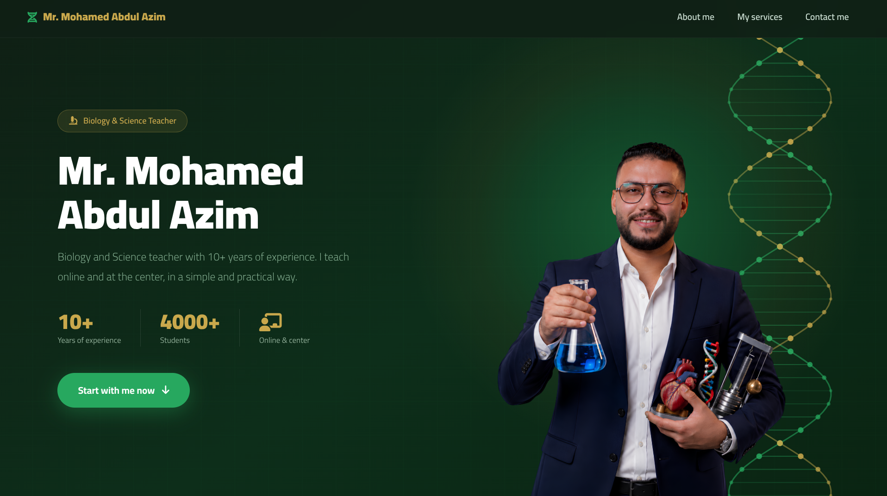

 

# 🧬 Mr. Mohamed Abdul Azim

### Biology & Science Teacher Portfolio

A professional portfolio showcasing teaching experience, educational expertise, teaching services, and contact information through a modern and responsive design.

---

## 📖 About the Project

**Mr. Mohamed Abdul Azim Portfolio** is a personal portfolio website designed to highlight a Biology and Science teacher's professional background, teaching experience, educational approach, and available services.

The portfolio provides students and visitors with an overview of the teacher's qualifications, experience, educational offerings, and communication channels through a clean and user-friendly interface.

## ✨ Key Features

- 🎓 **Professional Profile** — Presents the teacher's background, expertise, and teaching experience.
- 📊 **Experience Statistics** — Highlights professional experience and student reach.
- 📚 **Teaching Services** — Showcases Biology lessons, Science classes, and exam preparation services.
- 📱 **Contact & Social Links** — Provides direct access to contact information and social media platforms.
- 📱 **Responsive Design** — Adapts seamlessly to desktop, tablet, and mobile screens.
- ⚡ **Interactive Navigation** — Features smooth scrolling and active section navigation.
- ☰ **Mobile Navigation** — Provides an accessible navigation menu for smaller screens.

## 🗂️ Portfolio Sections

- **Home** — Introduces the teacher and highlights his professional identity.
- **About Me** — Presents teaching experience, professional background, and educational approach.
- **My Services** — Showcases available Biology and Science lessons and exam preparation.
- **Contact Me** — Provides contact details and social media links.

## 🛠️ Tech Stack

- **HTML5**
- **CSS3**
- **JavaScript**
- **Font Awesome**
- **Google Fonts**
- **Responsive Design**

## 🖥️ Website Preview

  

## 🌐 Live Website

## </> Developers

**Developed by [Raed Mosaed](https://github.com/raedmosaed0) & [Mohamed Samir](https://github.com/PrimeDevX)**

---

© 2026 Mr. Mohamed Abdul Azim Portfolio. All Rights Reserved.
